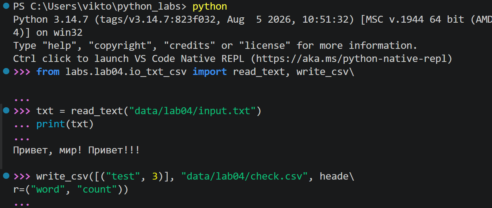
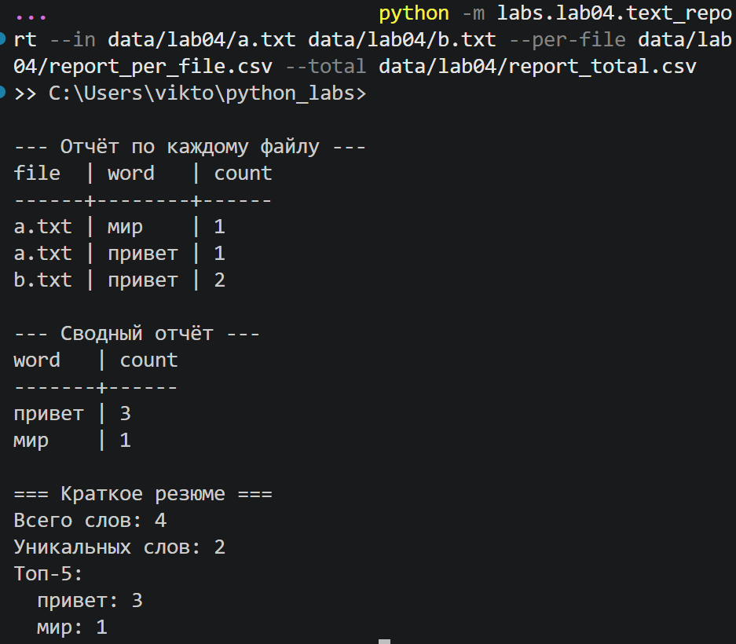

<h1>ЛР4 — Файлы: TXT/CSV и отчёты по текстовой статистике</h1>

Цель: закрепить работу с файлами (чтение/запись, кодировки), автоматизировать сбор статистики по словам и выгружать её в CSV.

<h2>Задание А</h2>
Реализован независимый модуль ввода/вывода, содержащий чистые функции с аннотациями типов и докстрингами:

- <b>ensure_parent_dir</b>: проверяет существование целевой директории для файла и автоматически создаёт её, если она отсутствует.
- <b>read_text</b>: открывает и считывает текстовый файл целиком в одну строку в заданной кодировке (по умолчанию UTF-8). В докстринге описана возможность явной смены кодировки (например, `encoding="cp1251"`).
- <b>write_csv</b>: принимает итерируемый объект со строками, валидирует их на одинаковую длину (иначе поднимает `ValueError`) и записывает данные в CSV-файл с разделителем «,».

Обработаны краевые случаи:
- Пустой входной файл корректно считывается как пустая строка `""`.
- Вызов `write_csv` без данных и без заголовка создаёт пустой файл размером 0 байт. Если передан только `header`, записывается файл, состоящий из одной строки заголовков.

<h2>Задание В</h2>
Написан консольный скрипт для комплексного анализа текстовых файлов. Скрипт принимает аргументы командной строки через стандартный модуль `argparse` и выполняет следующие шаги:

1. Читает входной файл (по умолчанию `data/lab04/input.txt`).
2. Очищает, токенизирует текст и собирает частоты, используя переиспользуемые функции `normalize`, `tokenize`, `count_freq` из ЛР3.
3. Сортирует слова по критерию: частота ↓, алфавит ↑ (с помощью `top_n`).
4. Записывает результат в CSV-отчёт (по умолчанию `data/lab04/report.csv`) с колонками `word,count`. В случае пустого файла на входе, отчёт создаётся и содержит только строку заголовка согласно выбранной политике.
5. Выводит в консоль красивую, динамически выровненную таблицу результатов и краткое резюме (всего слов, уникальных слов, топ-5).

<h3>★ Дополнительно (Задание со звёздочкой):</h3>

- **Мультифайловый режим**: Скрипт принимает список путей через флаг `--in`. Частоты считаются по каждому файлу отдельно и суммируются в общий «тотал».

- **Раздельные отчёты**: Генерируется детальный CSV-отчёт `report_per_file.csv` (колонки `file,word,count`, сортировка: `file` ↑, `count` ↓, `word` ↑) и сводный агрегированный отчёт `report_total.csv`.

- **Табличный вывод**: В консоль параллельно с сохранением файлов выводятся приятно отформатированные таблицы, ширина столбцов в которых автоматически рассчитывается по максимальной длине контента.
