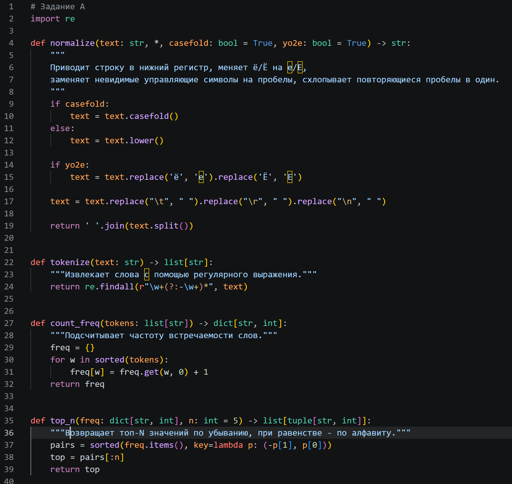
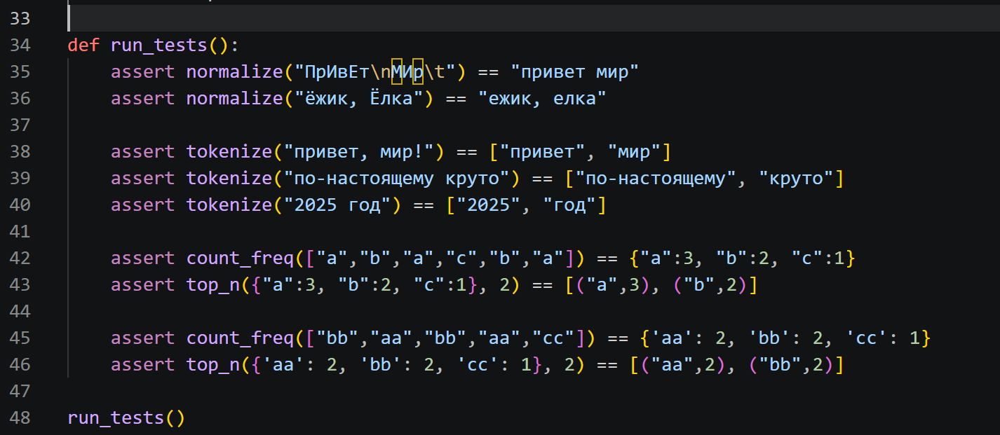
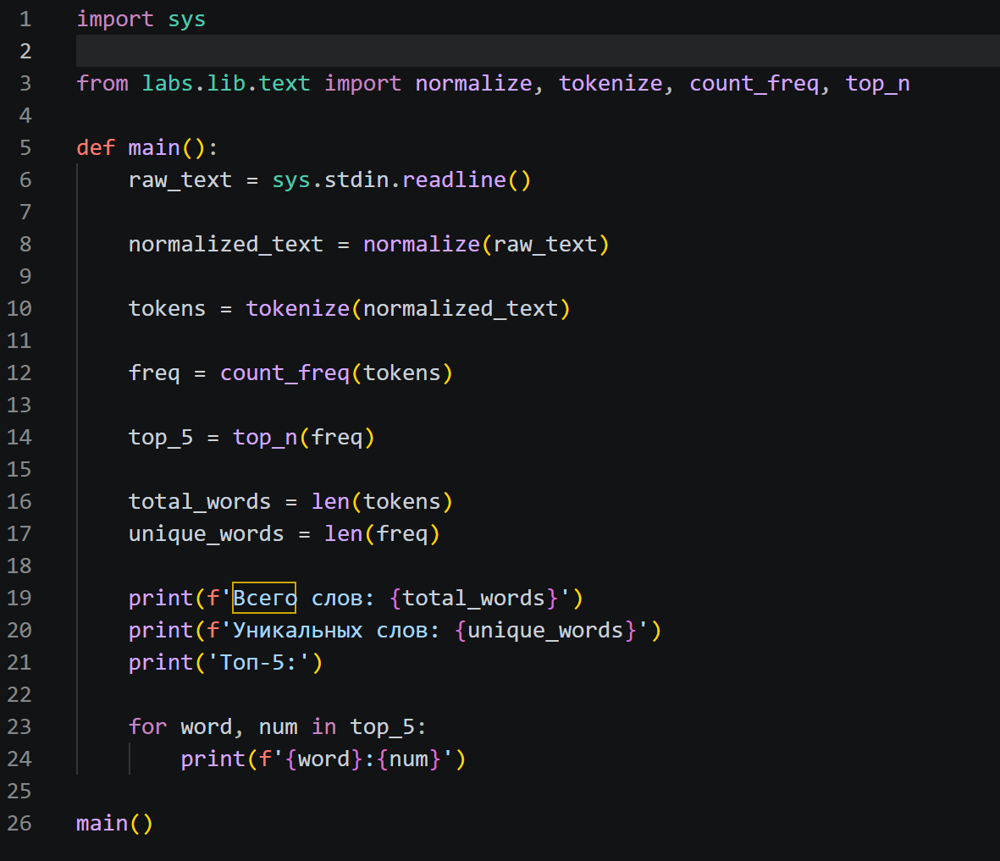
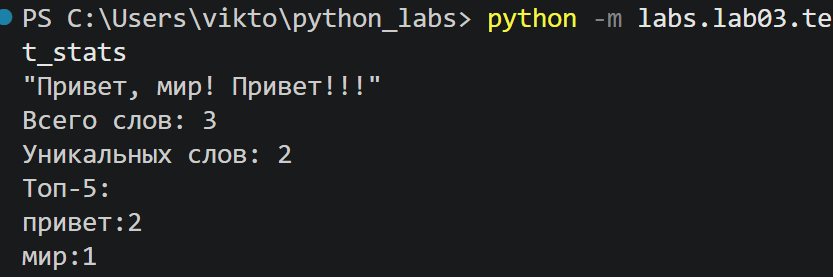

<h1>ЛР3 — Тексты и частоты слов (словарь/множество)</h1>

<h2>Цель</h2>

- Нормализовать текст, 
- Аккуратно токенизировать, 
- Посчитать частоты слов 
- Вывести топ-N.

<h2>Задание А - src/lib/text.py</h2>

Реализованы функции normalize, tokenize, count_freq, top_n. 
- normalize: приводит строку в нижний регистр, меняет ё/Ё на е/Е, заменяет невидимые управляющие символы на пробелы, схлопывает повторяющиеся пробелы в один.
- tokenize: извлекает слова с помощью регулярного выражения.
- count_freq: подсчитывает частоту встречаемости слов. Также список токенов сортируется по алфавиту.
- top_n: возвращает топ-N значений по убыванию, при равенстве - по алфавиту.

Также реализована функция автоматического тестирования, содержащая базовые контрольные assert-проверки для всех этапов обработки.

 

<h2>Задание В - src/lab03/text_stats.py</h2>
Программа считывает одну строку из стандартного потока ввода через sys.stdin.readline(), после чего очищает её, извлекает слова по регулярному выражению, рассчитывает их частотность и находит пять самых популярных слов. В финале программа вычисляет и выводит общее число слов и количество уникальных элементов вместе с финальным списком лидеров в консоль.

