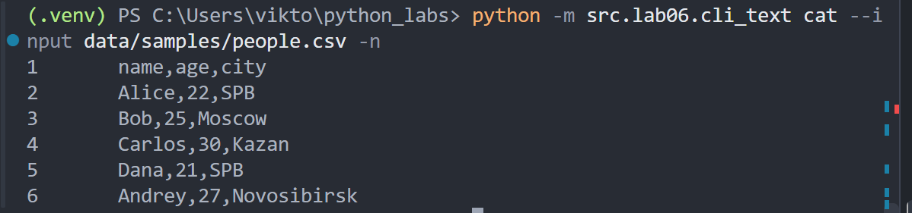
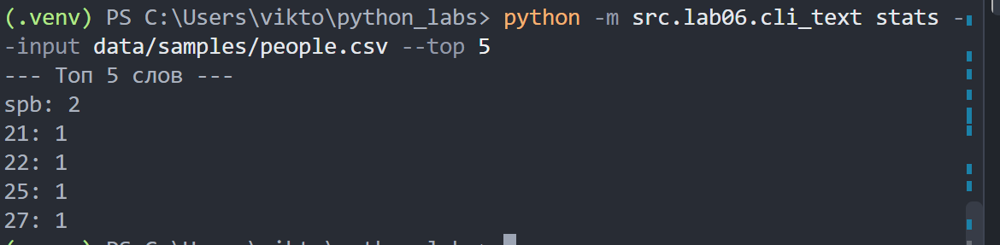
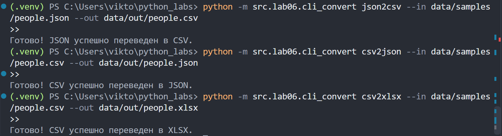
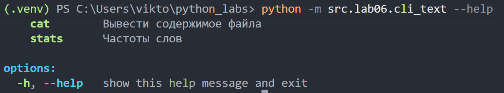

# ЛР6 — CLI‑утилиты с argparse (cat/grep‑lite + конвертеры): Отчет

## Цель
Научиться создавать консольные инструменты с аргументами командной строки, подкомандами и флагами.

## 1. Утилита для работы с текстом (`cli_text.py`)

Модуль предназначен для просмотра текстовых файлов и вывода частотной статистики слов.

### Подкоманды и флаги:
* `cat` — Выводит содержимое файла на экран.
  * `--input` — Путь к текстовому файлу (обязательный).
  * `-n` — Флаг для включения нумерации строк (опциональный).
* `stats` — Считает частоту слов в тексте (использует функции из ЛР3).
  * `--input` — Путь к текстовому файлу (обязательный).
  * `--top` — Сколько верхних позиций слов вывести (по умолчанию: 5).

### Примеры запуска в терминале:

* **Вывод файла с нумерацией строк:**
  

* **Топ-5 популярных слов в файле:**
  

---

## 2. Конвертер данных (`cli_convert.py`)

Модуль предназначен для преобразования файлов между форматами JSON, CSV и XLSX (использует функции из ЛР5).

### Доступные команды:
* `json2csv` — Переводит данные из JSON в CSV.
* `csv2json` — Переводит данные из CSV в JSON.
* `csv2xlsx` — Переводит данные из CSV в Excel таблицу (XLSX).

### Флаги для всех команд конвертера:
* `--in` — Путь к исходному файлу (в коде обрабатывается через `dest="input"`).
* `--out` — Путь, куда сохранить новый созданный файл.

### Примеры запуска в терминале:

---

## Валидация и обработка ошибок

Программа защищена от падений с помощью блоков `try-except`:

1. Если запустить команду без обязательных флагов или со знаком `--help`, `argparse` автоматически выведет встроенную инструкцию по использованию.
   

2. Если указать несуществующий файл, программа перехватит `FileNotFoundError` и выведет понятную ошибку через `parser.error()`, например:
   `error: Входной файл 'несуществующий_файл.txt' не существует.`
